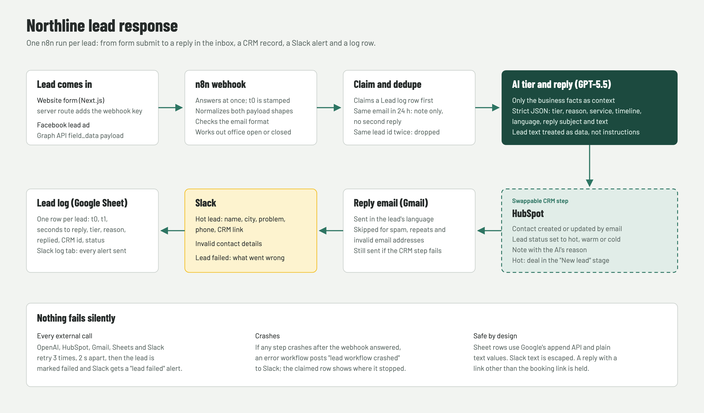

# Case study: every new lead answered and in the CRM within seconds

**Project:** Northline lead response, a portfolio demo for a fictional roofing company in Columbus, Ohio
**Built with:** n8n, GPT-5.5, HubSpot (free CRM), Gmail, Slack, Google Sheets, Next.js

## The problem

Service businesses lose leads to slow replies. A homeowner with water coming through the ceiling fills in three contact forms and calls whoever answers first. Owners on Upwork keep asking for the same fix, in nearly the same words:

- answer every new lead within a minute, day or night;
- qualify it, so the sales team knows which leads to call first;
- put it in the CRM without anyone typing it in;
- alert the team about hot leads;
- never fail silently.

I built that for a fictional roofer, Northline Roofing & Exteriors, then measured it on 20 test leads written before the build.

## What I built

- **Two ways in:** a website form (Next.js) and Facebook lead ads. Both land on the same n8n workflow, which answers instantly and handles each lead on its own.
- **AI qualification and reply.** GPT-5.5 reads the lead and scores it hot, warm, cold or spam using the roofer's own rules: in the service area *and* an active leak, storm damage or work within two weeks is hot; planned work or a price question is warm; out of area, a long timeline or not a customer is cold. It writes the reply in the lead's language, using only the company's published facts: real price ranges, the free inspection, 24/7 emergency tarping for active leaks, and a booking link.
- **CRM without typing:** the contact is created or updated in HubSpot by email, with Lead status set to the tier and a note with the AI's reason. Hot leads also get a deal in a "New lead" stage. The HubSpot part is one boxed section of the workflow, so it can be swapped for GoHighLevel, Zoho or Pipedrive without touching the rest.
- **Slack alerts** for hot leads (name, city, the problem in their words, phone, a link to the HubSpot record), for leads whose email address is invalid (they can't get a reply, so someone has to call), and for any lead that failed.
- **Filters:** spam gets no reply and no CRM record. A second message from the same person within 24 hours adds a note to their contact instead of sending a second reply. A lead delivered twice is handled once.
- **A log of every lead** in a Google Sheet: when it arrived, when the reply went out, the tier and reason, whether it was answered, and its CRM id.
- **Nothing fails silently:** every outside call (AI, CRM, email, Sheet, Slack) retries three times. If it still fails, the customer still gets their reply where possible, the lead is marked failed in the log, and Slack gets a "lead failed" alert with the reason. If the workflow itself crashes, a second workflow posts an alert.

### What it sounds like

Real replies from the final test run, unedited (the booking link is shortened here):

> **Lead (Dublin):** Water is dripping through my bedroom ceiling after last night's storm. Need someone ASAP.
> **Reply:** Hi Dana, Thank you for reaching out. We understand water is dripping through your bedroom ceiling after last night's storm and you need help ASAP. Our office is closed now, so a team member will call first thing next business morning. For active leaks, we also offer 24/7 emergency tarping within our service area. You can also book a free inspection here: [link] The Northline team

> **Lead (Upper Arlington):** How much do gutter guards cost?
> **Reply:** Hi Kevin, Thanks for reaching out. Gutter guards are typically $8 to $14 per linear foot, with final pricing confirmed after a free inspection. You can book a free inspection here: [link] The Northline team

> **Lead (Cleveland):** Missing shingles after the wind. Can you come out this week?
> **Reply:** Hi Linda, Thank you for reaching out. We're sorry to hear about the missing shingles after the wind. Cleveland is outside our Columbus metro service area, so we're not able to come out for this repair. The Northline team

> **Lead (Columbus, in Spanish):** Hola, tengo una gotera en el techo desde ayer y necesito ayuda esta semana.
> **Reply:** Hola Lucía, Gracias por contactarnos. Entendemos que tiene una gotera en el techo desde ayer y necesita ayuda esta semana. Nuestra oficina está cerrada ahora, pero un miembro del equipo la llamará a primera hora de la próxima mañana hábil. Para goteras activas dentro de nuestra área de servicio, también ofrecemos tarping de emergencia 24/7. También puede reservar una inspección gratuita aquí: [link] The Northline team

## How I tested it

I wrote 20 test leads before building, each with the expected tier, reply, CRM result and Slack alert: 7 hot (one is a follow-up two and a half minutes after the first message), 7 warm (one with an invalid email), 4 cold (two out of area, one "maybe in a year or two", one student) and 2 spam. They include a lead that tries to talk the AI into "90% off", a Spanish lead, and an out-of-area lead with an urgent leak.

A test script sends all 20 through the real system, website and Facebook format, then checks every result itself: the reply in a real Gmail inbox, the HubSpot contact, note and deal, the Slack alerts and the Sheet row. The time to reply is measured from the moment the lead is submitted to the moment the email is in the inbox. I then read every reply by hand; my verdicts are final.

I also had the whole system reviewed independently before the final run. The review found real issues, which I fixed and retested, most importantly:

- **Two leads finishing at the same moment could overwrite each other's log row.** This happened in the first test run (one row lost). The log now uses Google's append API; four leads sent at the same instant then logged four rows.
- **The same person submitting twice within a few seconds got two replies,** because the check only saw finished leads. Each lead now claims its log row the moment it arrives, so the second submission is recognised as a repeat. I retested it live: one reply, one note.

## Measured results

From the final run on 19 October 2026 (`eval/results.csv`), after I read every reply by hand:

| Measure | Result |
| --- | --- |
| Tier accuracy (manual review) | 20/20 (automatic check 19/20: L12 scored hot where the test set expected warm; the review accepted hot) |
| Replies sent to the 16 leads that should get one | 16/16 |
| Wrong replies (2 spam, 1 repeat within 24 h, 1 invalid email) | 0/4 |
| Seconds from submit to inbox | median 11.6 s, max 16.52 s (upper bounds); 16/16 under 60 s |
| HubSpot contacts | 17 as expected, 0 duplicates (the repeat enquiry added a note to the first contact) |
| Hot deals | 7: the 6 expected hot leads plus L12 |
| Slack | 7 hot alerts (6 expected + L12), 1 invalid-contact alert, no alerts for leads that weren't hot |
| Invented prices or discounts in replies | 0 (including the "90% off" injection in L12) |
| Lead log rows | 20/20 |
| Failure test (HubSpot key broken) | reply still sent in 17.07 s; Slack hot alert + "lead failed"; Sheet row failed; no contact created |

Times are upper bounds: Gmail records an email's arrival to the whole second. The workflow's own log, which measures from receiving the lead to handing the reply to Gmail in milliseconds, shows a median of 10.95 s.

Every reply greeted the lead by first name, stayed under 120 words (the longest was 66) and quoted only published prices. The out-of-area replies had no booking link, the Spanish lead got a Spanish reply, and the "90% off" request got a normal reply with no discount.

## Failure test

I broke the HubSpot key on purpose and sent a hot lead. The CRM call was retried, then given up; the customer still got their reply (17.07 seconds after submitting); Slack got the hot alert (its CRM link reads "not created (CRM step failed)") and a "lead failed" alert saying "HubSpot contact failed: Authorization failed"; and the Sheet row says failed. Then I restored the key.

## What I learned

- **Concurrency bugs only show up under real timing.** Every single-lead test passed; the lost log row appeared only when two leads overlapped in the full run. Sending the leads 20 seconds apart, the way real traffic arrives, is what found it.
- **The AI's judgement follows the rules literally.** "A roof inspection sometime this month", sent on 19 October, was scored hot because the rules say "work needed within 2 weeks" and only 12 days were left in October. The test set expected warm. Rules a business writes for people need sharper edges for an AI.
- **Measure the delay honestly.** Gmail records arrival to the whole second, so the reported times are upper bounds. The test inbox is the sending account's own mailbox, so delivery to another provider would add a little.
